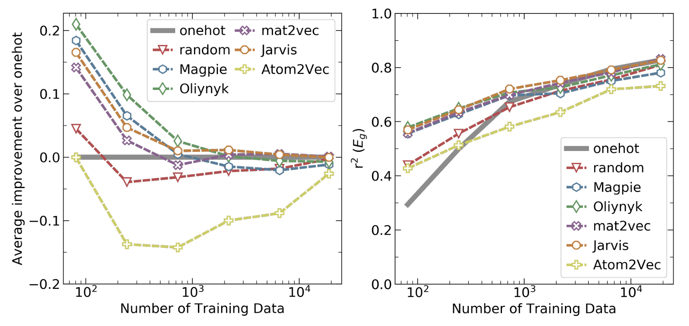

Every material you use today has a story behind it. Many of those stories are about years and years of hard work, a lot of patience, some smart thinking, and a little bit of luck. But...

> Can we keep finding new materials the old way, or do we need a new tool in the toolbox?

Our answer is that machine learning (ML) is becoming a **normal step** in how we find and improve materials. It does not replace the scientist or the lab. It helps us decide **where to look**, so that our time in the lab counts for more.

## The old way: hard work plus luck

Traditionally, materials discovery looks something like this:

**discovery = a lot of effort + some luck + careful fine-tuning**

The effort means knowing a family of materials very well, trying many ways of making them, and then testing what comes out. The luck means noticing the one result that is different.

Two famous examples show the effort side:

- **Thomas Edison and the light bulb filament.** Edison tried platinum and many carbonised plant fibres: boxwood, cedar, flax, bamboo and more. He later said he "tested no fewer than 6,000 vegetable growths" to find a good filament. Imagine he and his assistants spending hours inside the laboratory day-in and day-out, trying one material after the other with no promising results. It's easy to feel that this might never work, and yet they kept going until they tested a carbonised cotton thread which lasted about 15 hours. And then it's a matter of fine-tuning. The later improvements made filaments last much longer.

:::{note} Local vs global best
When we search step by step, we often find a result that is **good compared with its neighbours**, and we stop there. That is a *local* best. The *global* best may be somewhere we never looked. Edison's cotton thread was a local best; later filaments were much better.
:::

- **Shuji Nakamura and the blue LED.** Around 1988, Nakamura started looking for a material for blue LEDs. He chose gallium nitride (GaN), which was a big risk, because most researchers were working on zinc selenide (ZnSe) at the time as it looked more promising than GaN. He spent months rebuilding his growth equipment, then making and testing crystals day after day. By late 1993 he had a working device. He shared the 2014 Nobel Prize in Physics for this work.

These are just two of many material discoveries & inventions that only a few exceptionally driven people could have achieved. 
Sometimes discoveries came from luck:

- **Saccharin** (1879): Constantin Fahlberg noticed a sweet taste on his hands after working with coal-tar chemicals.
- **Aspartame** (1965): James Schlatter found it by chance while working on a different problem.
- **Stainless steel** (1913): Harry Brearley was testing materials for gun barrels that could withstand extreme heat, when he noticed one small shiny peice of steel among many rusted peices in a discarded pile.
- **vulcanised rubber** (Charles Goodyear), **Teflon** (DuPont) and **glass-ceramics** (Donald Stookey at Corning) all have very interesting stories of a surprise result that someone was ready to notice.

These are great stories. But look at what they need: years of one person's time, a happy accident or both. **Neither of these can be planned.**

## Why the old way is not enough

The world needs new materials faster than before. We need them for new technology, and also to fix problems that technology created: plastic waste, climate change and energy storage.

The bigger problem is the size of the **design space**. Let's do a rough count.

There are about 80 elements that are not radioactive. Take just **3 different elements** and mix them in equal amounts. The number of combinations is:

$$
C(80,3) = \frac{80!}{3!\,77!} = 82{,}160
$$

With **4 different elements**:

$$
C(80,4) = \frac{80!}{4!\,76!} = 1{,}581{,}580
$$

That is about **1.6 million** mixtures, and we only allowed equal amounts of each element. Now add:

- different ratios of each element,
- small amounts of dopants,
- different crystal structures,
- different ways of making the material (temperature, time, pressure…).

The number becomes far too large to test in a lab, even in many lifetimes. So we need a smarter way to approach this problem. 

We need a way to *filter* through all of these potential materials, and shortlist those materials that have a chance of exhibiting the properties that we are looking for.

But first, perhaps a good way to start off is to understand that many of these mixtures will not be thermodynamically stable and will decompose into other forms. So, whatever application you are looking for, these unstable materials will not be of interest. So in practice we can first remove the ones that make no sense. Even then, a lot remain.

## What ML changes

ML does not make materials for us. What it does is help us **shortlist**. Instead of testing everything, we:

1. **Learn** from the data we already have (past experiments, databases, simulations).
2. **Predict** the property for many materials we have *not* made yet.
3. **Shortlist** the most promising ones, and also the ones we know least about.
4. **Make and test** only the shortlist in the lab.
5. **Add** the new results to the data and repeat.

You will meet this idea in Bayesian optimisation that we will talk about shortly. An added advantage of Bayesian optimization is that it rewards trying places we know little about, it can **jump past a local best** instead of getting stuck there.

Here are some of the ways ML is already used in materials work:

| Use | Example |
|---|---|
| **Property prediction** | Band gap, thermal conductivity, superconducting temperature (Tc), formation energy, elastic moduli |
| **Materials informatics** | Building large, clean datasets of properties, structures and synthesis recipes |
| **Processing–structure–property links** | How heat treatment changes grain size, and grain size changes strength |
| **Phase stability** | Predicting which compounds are stable, to build phase diagrams faster |
| **Faster simulations** | ML models that copy expensive physics simulations at a fraction of the cost |
| **Computer vision** | Reading microscope images automatically: grains, cracks, defects |
| **Autonomous labs** | Robots that make and test samples, with ML choosing the next experiment |
| **Inverse design** | Starting from the property you want and asking what material could give it (often deep learning) |

## Materials ML is not the same as "normal" ML

Much of ML was built for large, clean datasets such as photos, text or online shopping. Materials data are different, and that changes how we work.

| Point | Typical ML (e.g. photos, text) | Materials ML |
|---|---|---|
| **Amount of data** | Often huge: millions of examples | Often small: tens to thousands of examples |
| **Features** | The model can often learn them itself | Choosing good features matters a lot |
| **Uncertainty** | Small errors are often fine | We need to know how sure the model is, because each test is expensive |
| **Understanding the model** | Often less important | Very important: we want to learn the *science*, not just the answer |
| **Goal** | Predict the usual case well | Learn from the usual cases, then find the **unusual** ones: the hardest, the lightest, the best conductor |

That last row is the key difference. In materials, we usually do not want the average material. We want the **extreme** one. So we must **extrapolate**: predict outside the data we trained on. This is the hardest thing to ask of any model.

## Why domain knowledge still matters

If ML learns from data, do we still need materials science knowledge? [A study by Murdock, Kauwe, Wang and Sparks (2020)](https://chemrxiv.org/doi/pdf/10.26434/chemrxiv.11879193.v1) tested exactly this. They compared different ways of turning a chemical formula into numbers (features):

- **Simple features** with no chemistry inside (for example, "one-hot" encoding, which only records which elements are present), and
- **Knowledge-based features** built from real element properties (for example, **Magpie**, which uses atomic mass, electronegativity and so on).

What they found:

- With **small datasets** (around a hundred to a few hundred materials), knowledge-based features gave clearly better predictions.
- With **large datasets** (around ten thousand or more), the difference mostly disappeared. The model could learn the chemistry from the data itself.

Since most materials datasets are small, **domain knowledge is still a big help**.

They also tested extrapolation. They removed every compound containing **magnesium** from the training data, then asked the models to predict the bulk modulus of those magnesium compounds. The scores (r², where 1 is perfect) were:

| Features | r² on unseen Mg compounds |
|---|---|
| one-hot | 0.29 |
| random | 0.30 |
| Magpie | 0.65 |
| Atom2Vec | −0.80 |
| mat2vec | 0.79 |
| Jarvis | 0.77 |
| Oliynyk | 0.74 |

Simple features did poorly. They had never "seen" magnesium, so they had nothing to go on. Features that describe **what magnesium is like** let the model make a sensible guess about compounds it had never seen. One learned feature set (Atom2Vec) did worse than just predicting the average; its r² is below zero.

**The lesson:** good features carry the science into the model. That is what makes extrapolation possible.

## Being honest about the limits

ML is powerful, but it is not magic:

- **It is still young in materials.** Only a small number of useful materials have been found mainly through ML so far. The promise is real, but so is the work left to do.
- **Extrapolation is risky.** A model can be very confident and very wrong far from its training data. That is why uncertainty (as in GPR) matters.
- **Data can be biased.** Databases contain what people chose to study and publish. Failed experiments are often missing. A model learns those gaps too.
- **Cleaning data takes effort.** Collecting, checking and cleaning materials data is often the biggest part of the job.

Even with these limits, ML can save a lot of time and cost, because each lab experiment becomes a **better-chosen** experiment.

## The big picture

| | Traditional discovery | ML-guided discovery |
|---|---|---|
| **How we choose what to try** | Experience, intuition, trial and error | Predictions + uncertainty + experience |
| **How many candidates we can consider** | Tens to hundreds | Thousands to millions, on a computer |
| **What we learn from failures** | Stays in one lab notebook | Goes back into the data and improves the next choice |
| **Role of luck** | Large | Smaller: we make our own luck by searching wisely |

The scientist is still at the centre. You decide the question, choose good features, check that predictions make physical sense, and do the experiments. ML helps you **search a huge space in a smart way**. That is why we treat it as a standard step in materials discovery, and why it is the focus of this course.

