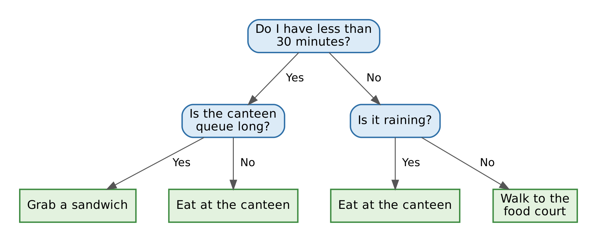

# Week 7 — What to expect 🤔

**Decision Trees & Random Forests**

In the next lecture we move to a new family of models. So far, most of our models have been equations: Decision trees work by making a prediction by asking a series of simple questions, one after another.

The good news: you already do this every day.

**Decision Trees** 🌳

A decision tree you already use

Think about how you decide where to have lunch on a busy weekday. You probably don't calculate anything. You just ask yourself a few quick questions:

Notice three things:

* Each question has a simple answer (yes or no). That is a split.

* The order matters. The first question ("how much time do I have?") is the most important one, so it comes first.

* Each path ends in a decision. That end point is called a leaf.

That's a decision tree. The only difference in machine learning is that the computer learns the questions from data. It decides which question to ask first, what the cut-off should be ("less than 30 minutes" vs "less than 20 minutes"), and when to stop asking.

**Random Forests** 🌳🌴🌲🌵

Random forest is a collection of Decision trees.
Build many different decision trees and let them vote (classification) or average their answers (regression). Each tree sees a slightly different random sample of the data and of the features, so their individual mistakes tend to cancel out. Think of it as asking many friends for advice instead of just one.

:::{admonition} 📢 Words to listen for
:class: note

- **Root node** — the first question the tree asks
- **Split** — a question that divides the data into two groups
- **Leaf** — an end point of the tree, where a prediction is made
- **Depth (max_depth)** — how many questions in a row the tree is allowed to ask
- **Impurity** — how "mixed" a group is; the tree chooses splits that make groups less mixed (Gini and entropy for classification, squared error for regression)
- **Overfitting** — when a deep tree memorises the training data
- **Pruning** — cutting back a tree so it generalises better
- **Ensemble** — a model built by combining many models
- **Bootstrap / bagging** — giving each tree its own random sample of the training data
- **Feature importance** — a score showing which features the forest relied on most :::

**🐍 Python**

We will be using the the following models from sklearn

[Random Forest Classifier](https://scikit-learn.org/stable/modules/generated/sklearn.ensemble.RandomForestClassifier.html)

